## Overview {#preview}

. . . 

- Introduction

. . . 

- Multi-Robot Motion Planning Methods 

. . . 

- Overview of my Dissertation

. . .  

- Summary 

# Introduction 

## Autonomous Multi-Robot Systems

Multiple robots can accomplish tasks that are impossible, inefficient, or unsafe for a single robot, enabling *scalable*, *robust*, and *efficient* operation in complex environments.

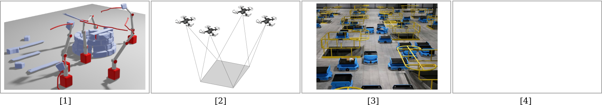

. . . 

What is required to *build* these systems?


## The Classic Robotics Pipeline

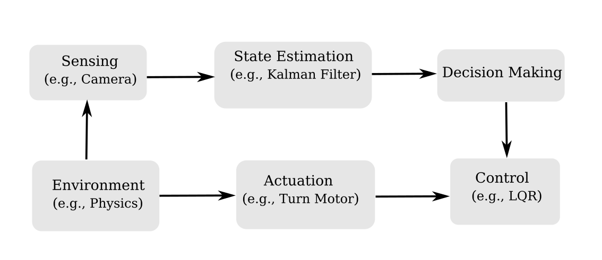

. . .

::: {.container}

:::: {.col .element: class="fragment" data-fragment-index="2"}
::::: {.box-green}
Motion Planning is a *part of desicion making*: how to *reach the goal*, *given the state* of the robot and environment, without collisions.
:::::
::::
:::

## Multi-Robot Motion Planning

<video width="70%" autoplay muted loop playsinline>
  <source src="media/video/phd-defense/mrmp-problem.mp4" type="video/mp4">
</video>

Move each robot from its start state ($\mathbf{s}_1$, $\mathbf{s}_2$) to its goal state ($\mathbf{g}_1$, $\mathbf{g}_2$) while avoiding obstacles and collisions with other robots.

## Discrete and Continuous Motion Planning 

::: {.container}
:::: {.col .element: class="fragment" data-fragment-index="1"}
::: {.box-white}
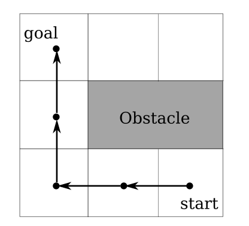
:::
- Discrete time steps
- Grid representation of the world
::::

:::: {.col .element: class="fragment" data-fragment-index="2"}
::: {.box-white}
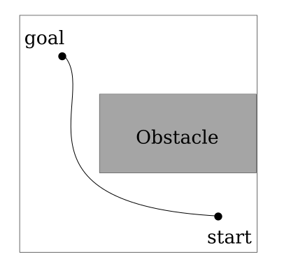
:::
- Continuous state & time
- Infinite possible motions
::::

:::


## Discrete and Continuous Motion Planning 

::: {.container}
:::: {.col}
Multi-Agent Path Finding/MAPF (Discrete)
::::
:::: {.col}
Kinodynamic Motion Planning (Continuous)
::::
:::

# Multi-Agent Path Finding (MAPF)

## Multi-Agent Path Finding (MAPF)

Robots move on a graph, one step per timestep, from start to goal states.

::: {.container}
:::: {.col}
- Inputs: 
  - start, goal
  - environment
  - robot shape
- Output: 
  - sequence of states.
::::
:::: {.col}
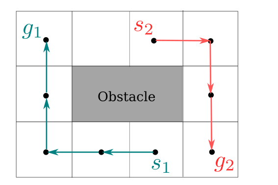{width=400}

::::
:::

. . .

::::: {.box-white}
Conflicts - egde and vertex.

Complexity - with each robot the joint configurations grows exponentially.
:::::

## MAPF Example

```{=html}
<video data-autoplay src="media/video/nu/mapf-example.mp4" width="60%"></video>
```
<p style="font-size: 0.7em; color: gray;">Source: Keisuke Okumura</p>


## Why MAPF Is Not Enough for Real Robots?


<video width="60%" autoplay muted loop playsinline>
  <source src="media/video/nu/mapf-example2.mp4" type="video/mp4">
</video>


MAPF captures combinatorial interaction, but *ignores* robot dynamics.


## Robot Dynamics

::: {.box-green}
:::: {.box-green-title}
Car-with-trailer Dynamics
::::
- States: $\mathbf{x} = (x, y, \theta_1, \theta_2)$
- Actions: $\mathbf{u} = (v, \phi)$
- Dynamics: $\mathbf{\dot{x} = \mathbf{f}(\mathbf{x}, \mathbf{u})}$, more precisely:

$\dot{x} = v \cos \theta_1, \quad \dot{y} = v \sin \theta_1, \quad \dot{\theta_1} = \frac{v}{L}\tan \phi$,  $\quad \dot{\theta_2} = \frac{v}{L_h} \sin (\theta_1 - \theta_2)$

:::

{width=400}

. . .

Motion planning now considers *how* to move, not just where.

# Multi-Robot Kinodynamic Motion Planning

## Multi-Robot Kinodynamic Motion Planning

Searches for *dynamically feasible*, *continuous time* trajectories for all robots.

. . .

::: {.container}
:::: {.col}
- Inputs: 
  - start, goal
  - environment
  - robot shape
- Output: 
  - collision-free sequence of states, that obey *robot dynamics*.
::::
:::: {.col}
<video 
  data-autoplay 
  src="media/video/nu/kinodynamic-planner-example.mp4"
  style="width: 100%; margin: 30px auto; display: block;">
</video>
::::
:::

## Multi-Robot Kinodynamic Motion Planning Methods

::: {.container}
:::: {.col .element: class="fragment" data-fragment-index="1"}
::: {.box-white}
:::: {.box-blue-title}
MAPF + Post-processing
::::
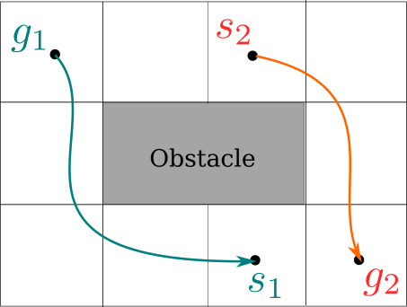
<div style="font-size:0.6em; color:gray; margin-top:-1.1em;">
Hönig et al., 2018; Luis et al., 2020;
</div>
:::
- Dynamically feasible
- Smooth trajectories
- <span style="color:red">Suboptimal trajectories</span>
::::

:::: {.col .element: class="fragment" data-fragment-index="2"}
::: {.box-white}
:::: {.box-blue-title}
Bezier/Spline-based 
::::
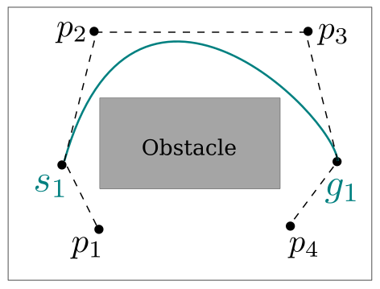
<div style="font-size:0.6em; color:gray; margin-top:-1.1em;">
Senbaslar et al., 2023; Yan & Li, 2024;
</div>
:::
- Scale well
- <span style="color:red">Suboptimal trajectories</span>
- <span style="color:red">Limited dynamics</span> 
::::

:::

. . .

Research Gap: 

- Model generality — Support arbitrary robot dynamics
- Close proximity operations, time-optimal trajectories, fast computation.


## Dissertation Contributions {#preview}

<div class="three-columns">

<div>
Time-Optimal Motion Planning
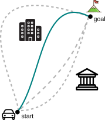

</div>

<div>
Interaction Awareness for Motion Planning
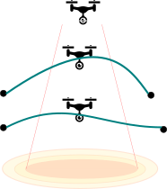

</div>

<div>
Fast, Scalable Motion Planning
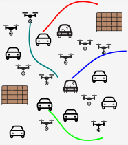

</div>

</div>

. . . 

<div class="three-columns">

<div>
Diffusion Model-based Motions
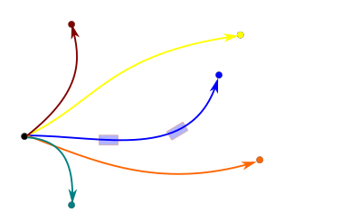

</div>

<div>
Virtual Omnidirectional Perception
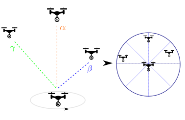

</div>

</div>


## Background

. . . 

A discontinuty-search with motion primitives 

. . . 

   - db-CBS, db-ECBS, db-PIBT, db-LaCAM algorithms evolved from this idea.

. . .

- Motion Primitive - short trajectories, which follows robot dynamics $\mathbf{x}_{k+1} = \mathbf{f}(\mathbf{x}_k,\mathbf{u}_k)$

{width=500}

. . . 

- discontinuity-bounded Search - allows for an user-defined discontinuity ($\delta$) between states

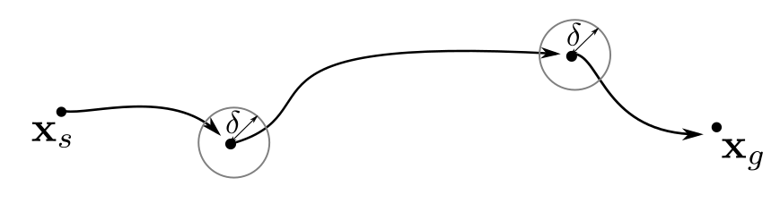{width=500}


## db-ECBS: Interaction-Aware Multi-Robot Kinodynamic Motion Planning {#preview}

. . . 

::: {.box-green}
- Probabilistically complete and asymptotically bounded suboptimal
- Reasons about interaction force between robots
- Scales up to 16 robots
:::


```{=html}
<video data-autoplay loop muted playsinline src="media/video/phd-defense/dbecbs-intro.mp4" width="80%"></video>
```

<div style="position:absolute; bottom:-60px; left:40px; right:40px; font-size:0.75em; color:gray;">
Moldagalieva, A., Ortiz-Haro, J., Hönig, W. (2025) <i>db-ECBS: Interaction-Aware Multirobot Kinodynamic Motion Planning</i>, IEEE Transactions on Robotics (T-RO).
</div>

## Aerodynamic Force between Flying Robots {#preview}

```{=html}
<video data-autoplay loop muted playsinline src="media/video/phd-defense/downwash.mp4" width="100%"></video>
```

. . . 

::::: {.box-red}
Robots can deviate from their planned trajectories, causing the lower robot to crash.
:::::

## Related Work

::: {.container}

:::: {.col}
::: {.box-def-two}
:::: {.box-blue-title}
Conservative Planner
::::
- Assumes ellipsoid shape around robots
- Scales well ($\le$ 32 robots)
- <span style="color:red">Fails in tight environments</span>

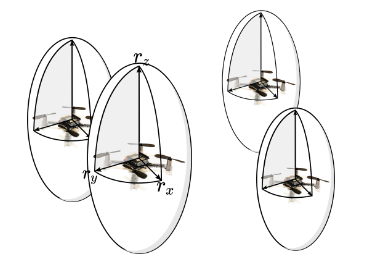

<div style="font-size:0.6em; color:gray; margin-top:-1.6em;">
Hönig et al., 2018;
</div>
:::
::::

:::: {.col}
::: {.box-def-two}
:::: {.box-blue-title}
Learning-based Planner
::::
- Learns residual dynamics
- Works with heterogeneous robots
- <span style="color:red">Assumes simplified 2D dynamics</span>
- <span style="color:red">Poor scalability ($\le$ 3 robots)</span>

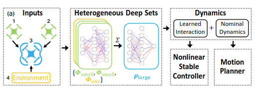

<div style="font-size:0.6em; color:gray; margin-top:0.1em;">
Shi et al., 2022; J. Li et al., 2023 
</div>
:::
::::

:::

## db-ECBS: Approach {#preview}

::: {.r-stack}

:::{.element: class="fragment current-visible"}
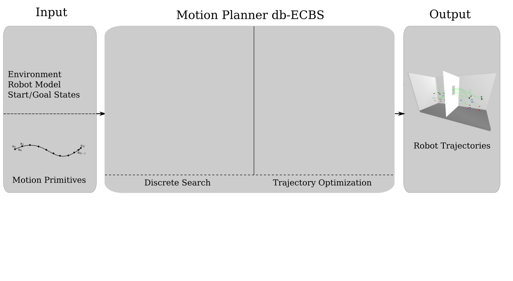
::::
:::{.element: class="fragment current-visible"}
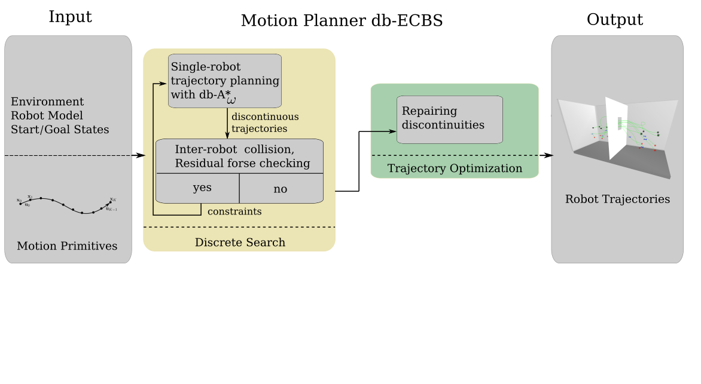

::::
:::{.element: class="fragment current-visible"}

::::
:::{.element: class="fragment current-visible"}
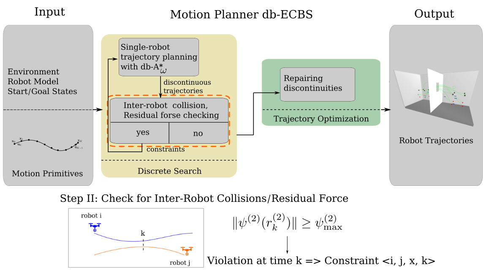
:::: 
:::{.element: class="fragment current-visible"}

::::
:::{.element: class="fragment"}
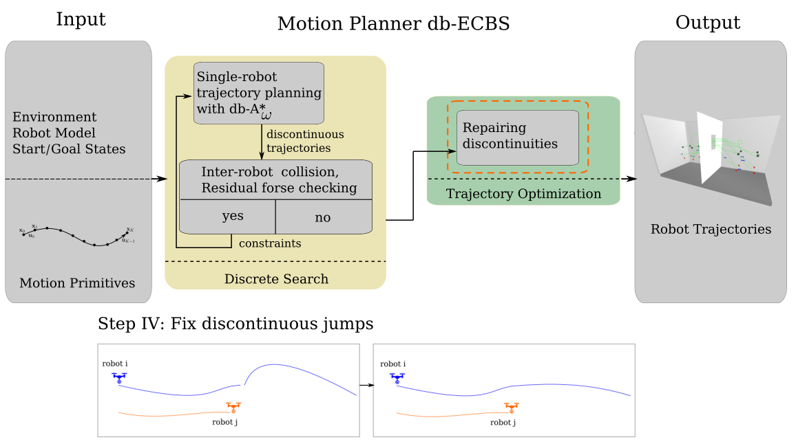
::::
:::

## db-ECBS: Performance Evaluation {#preview}

- Example: Swap-three (w/ aerodynamic interaction)

<div style="display: flex; align-items: center; gap: 2%;">

<div style="width: 75%;">

<video data-autoplay loop controls style="width: 100%;">
  <source src="media/video/nu/swap3-drone.mp4" type="video/mp4">
</video>

</div>

<div style="width: 50%;">

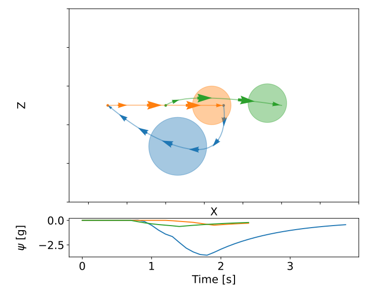

</div>

</div>

<span style="color:#e99a24;">Orange</span> - large size robot, <span style="color:blue;">blue</span> - small size robot.

. . . 

- letting the <span style="color:#e99a24;">large</span> robot under <span style="color:blue;">small</span> robots &rarr; lower solution cost


## db-ECBC: Performance Evaluation {#preview}

- Example: Window (w/ aerodynamic interaction)
- Platform: Crazyflie 2.1 robots

```{=html}
<video data-autoplay src="media/video/nu/dbecbs-uav.mp4" width="90%"></video>
```

. . . 

*Take away*:  Ellipsoidal robot shapes cause more frequent collisions in this small environment, increasing conflict-resolution time.

## db-ECBS: Limitations

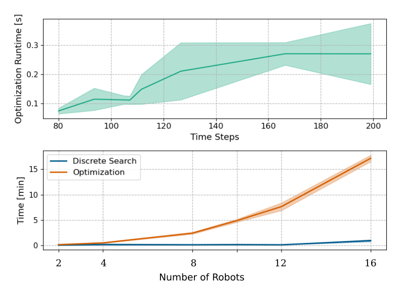

. . . 


- Computationally expensive
- Optimization complexity, sometimes fails to converge


# Fast and Scalable Motion Planner 


## db-LaCAM: Fast and scalable multi-robot kinodynamic motion planning with discontinuity-bounded search and lightweight MAPF {#preview}

. . . 

::: {.box-green}
- Scalability up to 50 robots
- Computational runtime up to 10x faster
:::


```{=html}
<video data-autoplay loop muted playsinline src="media/video/icaps/icaps-gif.mp4" width="70%"></video>
```

<div style="position:absolute; bottom:-100px; left:-20px; right:40px; font-size:0.75em; color:gray;">
Moldagalieva, A., Okumura, K., Prorok, A., Hönig, W. (2026) <i> db-LaCAM: Fast and scalable multi-robot kinodynamic motion planning with discontinuity-bounded search and lightweight MAPF</i>, International Conference on Automated Planning and Scheduling (ICAPS).
</div>


## db-LaCAM: Approach {#preview}

::: {.r-stack}

:::{.element: class="fragment current-visible"}
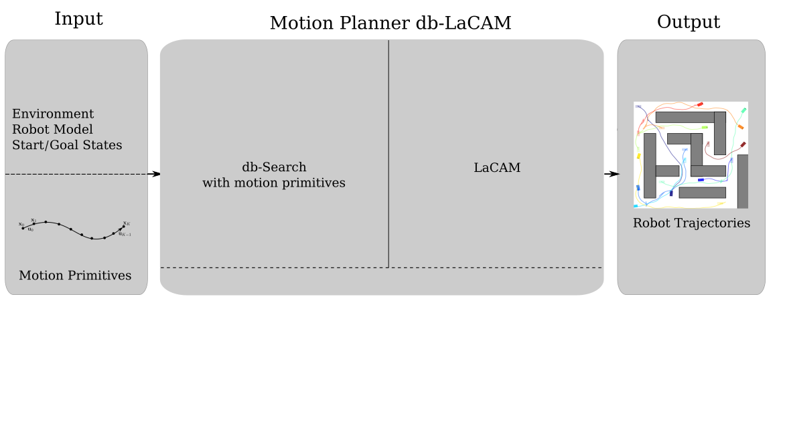
::::
:::{.element: class="fragment current-visible"}
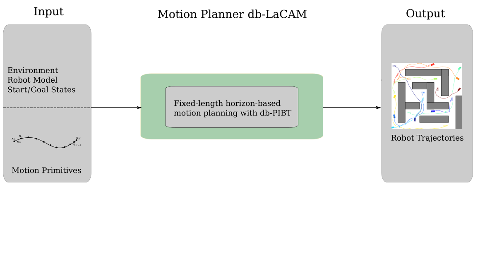
::::
:::{.element: class="fragment current-visible"}
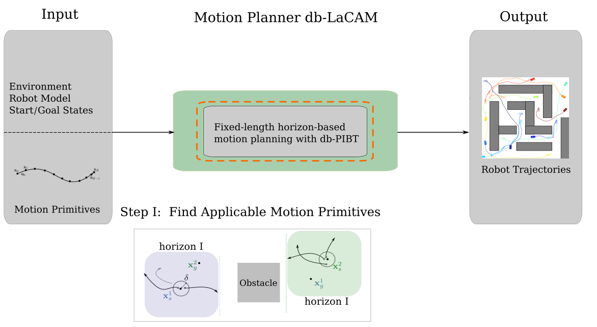
::::
:::{.element: class="fragment current-visible"}

:::: 
:::{.element: class="fragment current-visible"}
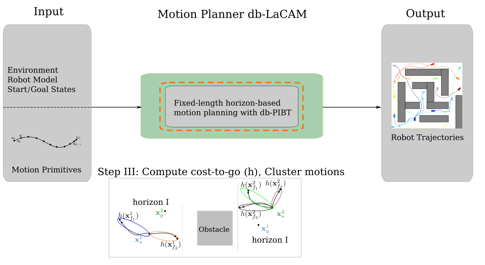
::::
:::{.element: class="fragment current-visible"}
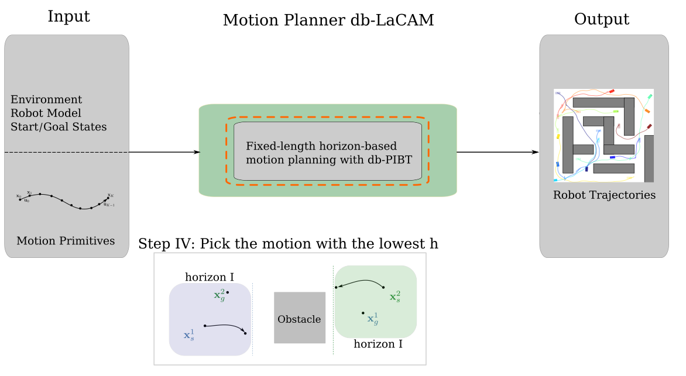
::::
:::{.element: class="fragment current-visible"}
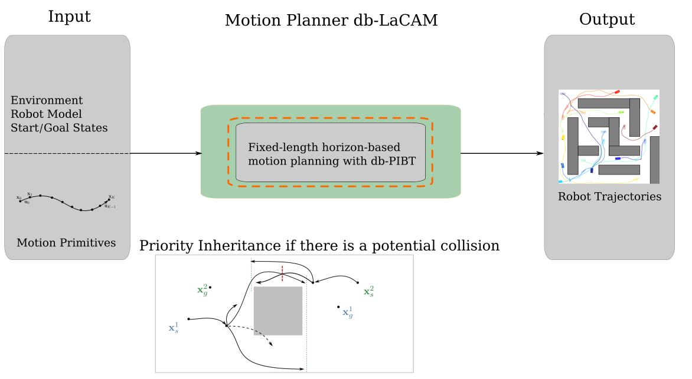
::::
:::{.element: class="fragment"}
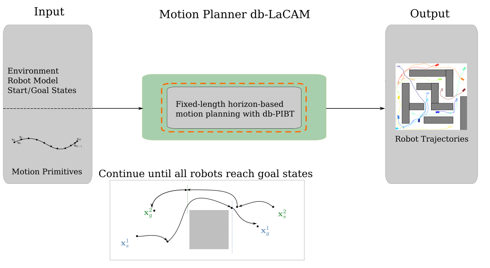
::::
:::


## db-LaCAM: Performance Evaluation {#preview}

::: {.r-stack}

:::{.element: class="fragment current-visible"}
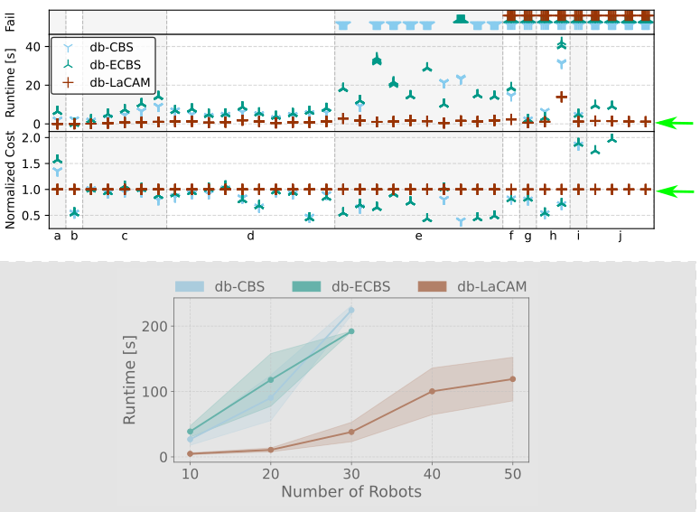
::::
:::{.element: class="fragment"}
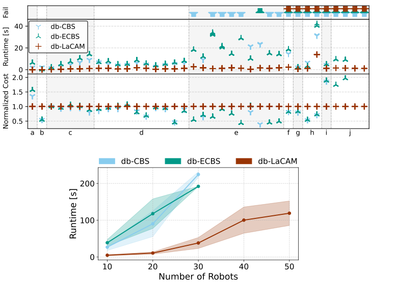
::::

:::

. . . 

*Take away*: db-LaCAM is up to $10\times$ faster than db-CBS and db-ECBS and scales better with team size. 

## db-LaCAM: Performance Evaluation {#preview}

Platforms: 10 Sanity drones, 4 Polulu robots with attached trailers.

```{=html}
<video data-autoplay loop muted playsinline src="media/video/nu/dblacam.mp4" width="100%"></video>
```

## db-LaCAM: Performance Evaluation {#preview}

- Example: Random with 50 robots
- Dynamics: unicycle ($1^{(st)}$ order)

```{=html}
<video data-autoplay loop muted playsinline src="media/video/phd-defense/n50_faster.mp4" width="60%"></video>
```
## db-LaCAM: Limitations {#preview}


- Struggles with instances with narrow passes

```{=html}
<video data-autoplay loop muted playsinline src="media/video/phd-defense/livelock-dblacam.mp4" width="100%"></video>
```

# Benchmarking Framework 

## Benchmarking Framework Design

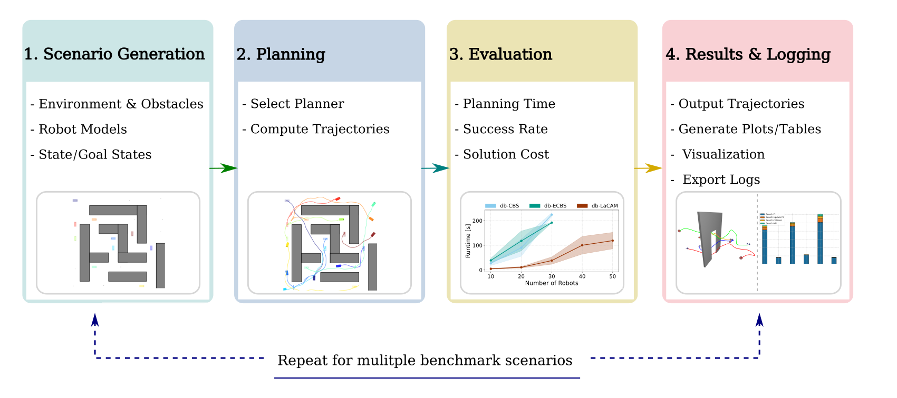


## Benchmarking Framework Design

::: {.container}

:::: {.col}
::: {.box-def-two}
:::: {.box-blue-title}
Environment Properties
::::
- Dimensions — width × height × height (2D/3D)
- Obstacle geometry — boxes, arbitrary meshes
- Obstacle size — dimensions/radius
- Obstacle placement — positions
- Narrow passages — minimum corridor/window width
:::
::::

:::: {.col}
::: {.box-def-two}
:::: {.box-blue-title}
Robot Properties
::::
- Number of robots
- Robot geometry — sphere, ellipsoid, box, etc.
- Robot size — radius / dimensions
- Robot state dimension
- Robot control dimension
- Robot state, action limits
- Dynamics model — integrator, unicycle, car-with-trailer, etc.
- Heterogeneity — whether robots have different dynamics, sizes
- Initial and goal states
:::
::::

:::


## Benchmarking Problem Instances {#preview}

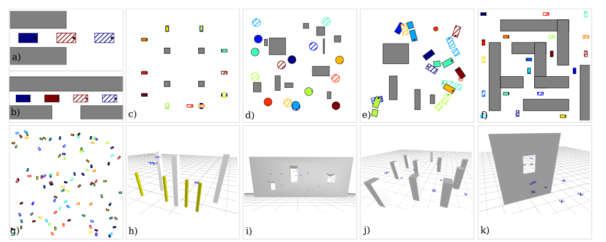

# Summary

## Take Aways

. . . 

- Real-world applications require *reasoning* about robot dynamics 

. . .

- There is no motion planners, which is generic (for now!)

. . . 

- Proper benchmarking is *important* to design the planner & evaluate it.

## Thanks! 


<p style="font-size: 0.7em; color: gray;">You can also email me at: akmaral.moldagalieva@alumni.nu.edu.kz</p>
