## Overview

- Introduction

- Kinodynamic Motion Planning Methods

- discontinuity-bounded Search

- Heuristic Estimation Methods

- Summary

# Introduction 

## Background

The term *kinodynamic planing* was introduced to refer to motion planning problems for which velocity and acceleration bounds must be satisfied (<span style="font-size:0.6em; color:gray;">B. R. Donald, 1993</span>).

. . . 

Kinodynamic Motion Planning = Motion Planning $+$ Robot Dynamics


## Robot Dynamics


::: {.box-green}
:::: {.box-green-title}
Car-with-trailer Dynamics
::::
- States: $\mathbf{x} = (x, y, \theta_1, \theta_2)$
- Actions: $\mathbf{u} = (v, \phi)$
- Dynamics: $\mathbf{\dot{x} = \mathbf{f}(\mathbf{x}, \mathbf{u})}$, more precisely:

$\dot{x} = v \cos \theta_1, \quad \dot{y} = v \sin \theta_1, \quad \dot{\theta_1} = \frac{v}{L}\tan \phi$,  $\quad \dot{\theta_2} = \frac{v}{L_h} \sin (\theta_1 - \theta_2)$

:::

{width=400}

## Motion Planning with Robot Dynamics

{width=700}

. . .

Motion planning now considers *how* to move, not just where.


## Motion Planning with Robot Dynamics

<video 
  data-autoplay 
  src="media/video/icaps/mrmp-example.mp4"
  style="width: 70%; margin: 30px auto; display: block;">
</video>


# Kinodynamic Motion Planning Methods


## Kinodynamic Motion Plannin: MAPF + POST


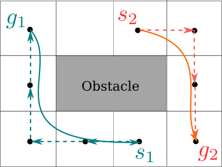{width=400}

<div style="font-size:0.6em; color:gray; margin-top:-1.1em;">
Hönig et al., 2018; Luis et al., 2020;
</div>

- MAPF
- Post-process with optimization
- <span style="color:red">Suboptimal trajectories</span>


## Kinodynamic Motion Planning: Bezier/Spline-based

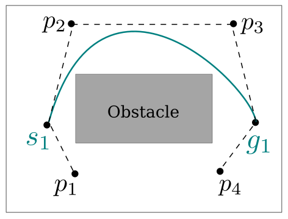{width=400}
<div style="font-size:0.6em; color:gray; margin-top:-1.1em;">
Senbaslar et al., 2023; Yan & Li, 2024;
</div>

- Trajectory using Bézier control points $(p_1,...,p_4)$
- <span style="color:red">Kinodynamic feasibility</span> is not guaranteed


## Kinodynamic Motion Planning: Motion Primitives

::: {.container}
:::: {.col .element: class="fragment" data-fragment-index="1"}
::: {.box-white}

<div style="font-size:0.6em; color:gray; margin-top:-1.1em;">
Shankar et al., 2025, Hou et al.,2025;
</div>
:::
- Discretized actions
- <span style="color:red">Expensive to hand craft</span>
::::

:::: {.col .element: class="fragment" data-fragment-index="2"}
::: {.box-white}

<div style="font-size:0.6em; color:gray; margin-top:-1.1em;">
Hönig et al., 2023; Moldagalieva et al., 2024, Moldagalieva et al., 2025;
</div>
:::
- Diverse maneuvers
- <span style="color:red">Stitching is non-trivial</span>
::::

:::


# discontinuity-bounded Search for Kinodynamic Motion Planning


## discontinuity-bounded/db-Search

Allows for an user-defined discontinuity ($\delta$) between states (<span style="font-size:0.6em; color:gray;">Hönig et al., 2023 Ortiz-Haro et al., 2025</span>)

{width=600}


## db-Search: Discrete Search

::: {.r-stack}

:::{.element: class="fragment current-visible"}


::::
:::{.element: class="fragment current-visible"}


::::
:::{.element: class="fragment current-visible"}
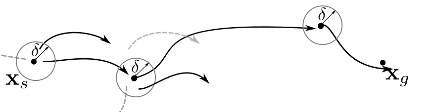
::::

:::

Motion is applicable iff $d(\mathbf{x}_k, \mathbf{x}_m) \leq \delta$, 

$d : \mathcal{X} \times \mathcal{X} \rightarrow \mathbb{R}^{+}$ - function that measures the distance between two states

$\mathbf{x}_k$, $\mathbf{x}_m$ - robot state, motions first state.


## db-Search: Discrete Search Output 


## db-Search: Discrete Search Output


```{=html}
<video data-autoplay loop muted playsinline src="media/video/talks/jumpy-solution-dbcbs.mp4" width="60%"></video>
```

. . . 

Output is jumpy - infeasible for real robot platforms. How to Fix It?


## db-Search: Fix discontinuous Jumps

With trajectory optimization (<span style="font-size:0.6em; color:gray;">Hönig et al., 2023 Ortiz-Haro et al., 2025</span>)

```{=html}
<video data-autoplay loop muted playsinline src="media/video/talks/db-search.mp4" width="100%"></video>
```

## db-Search: multi-robot motion planning

CBS/ECBS + db-Search = db-CBS (<span style="font-size:0.6em; color:gray;">Sharon et al., 2015, Moldagalieva et al., 2024, Moldagalieva et al., 2025</span>)

::: {.r-stack}

:::{.element: class="fragment current-visible"}


::::
:::{.element: class="fragment current-visible"}


::::
:::{.element: class="fragment current-visible"}
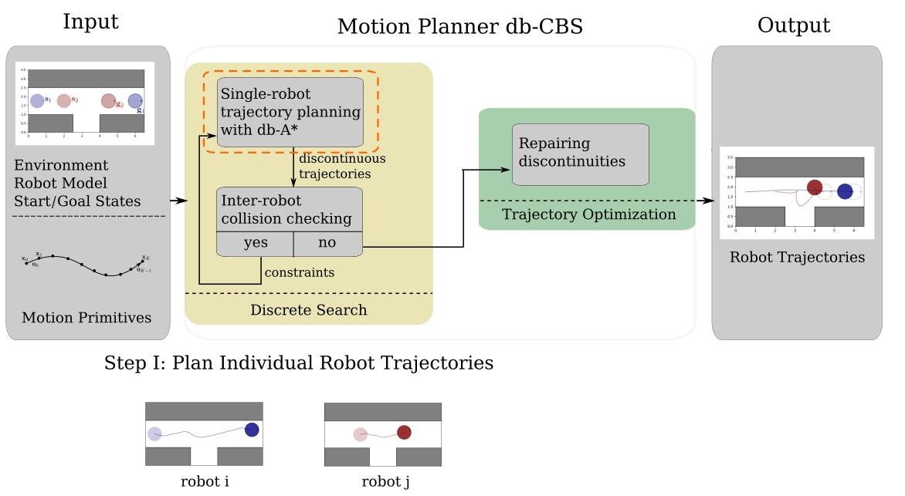
::::
:::{.element: class="fragment current-visible"}
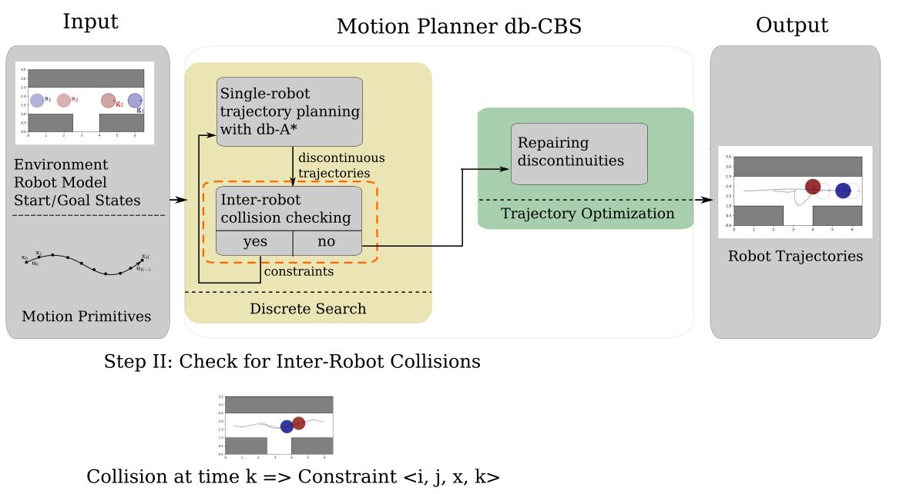
:::: 
:::{.element: class="fragment"}
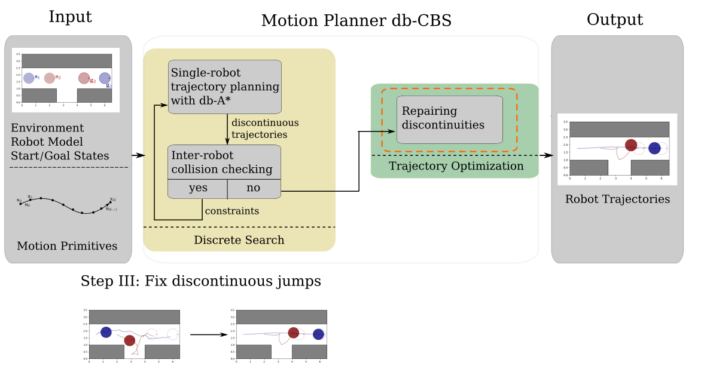
::::
:::


## db-Search: multi-robot motion planning

CBS/ECBS + db-Search (<span style="font-size:0.6em; color:gray;">Moldagalieva et al., 2024, Moldagalieva et al., 2025</span>)

```{=html}
<video data-autoplay loop muted playsinline src="media/video/talks/dbecbs-intro.mp4" width="100%"></video>
```


## db-Search with Optimization

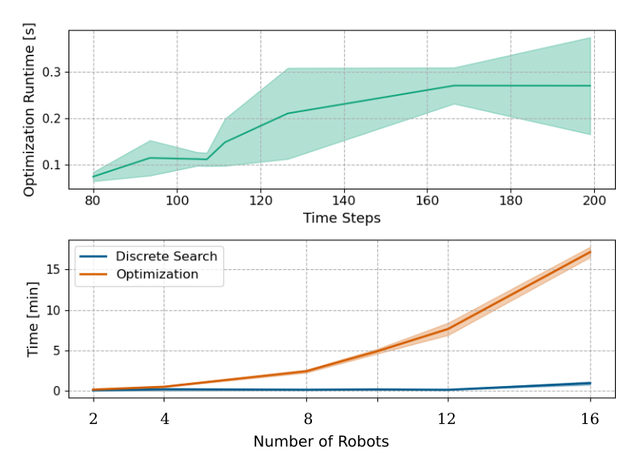

\begin{equation}
  \mathcal{O}\left(K\left(\sum_{i=1}^{N} \max\left(d_x^{(i)},d_u^{(i)}\right)\right)^3\right)
\end{equation}

$d^{(i)}_x, d^{(i)}_u$ - state and action dimensions of robot $i$, 
$N$ - number of robots, 
$K = \max_{i \in N} K^{(i)}$, $K^{(i)}$ - number of time steps in the discrete search solution of the $i^{\text{th}}$ robot.

## Kinodynamic Motion Planning: Motion Primitives 


. . . 

No discontinuity *$\rightarrow$* No optimization


## db-Search with Rollout

::: {.r-stack}

:::{.element: class="fragment current-visible"}
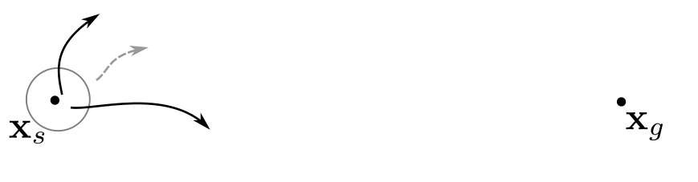

::::
:::{.element: class="fragment current-visible"}


::::
:::{.element: class="fragment current-visible"}


::::
:::{.element: class="fragment current-visible"}


::::
:::{.element: class="fragment current-visible"}


::::
:::{.element: class="fragment current-visible"}


::::
:::{.element: class="fragment current-visible"}


::::

:::


## db-Search: multi-robot motion planning

LaCAM + db-Search = db-LaCAM (<span style="font-size:0.6em; color:gray;">Okumura et al., 2023, Moldagalieva et al., 2026</span>)

::: {.r-stack}

:::{.element: class="fragment current-visible"}
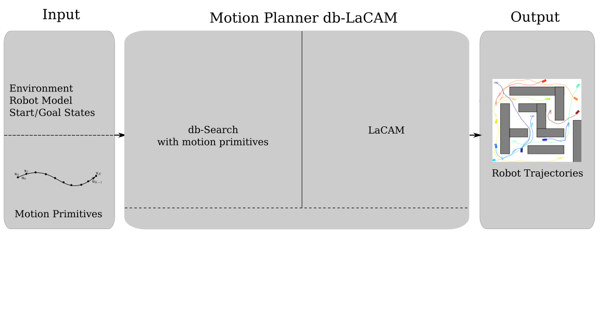
::::
:::{.element: class="fragment current-visible"}
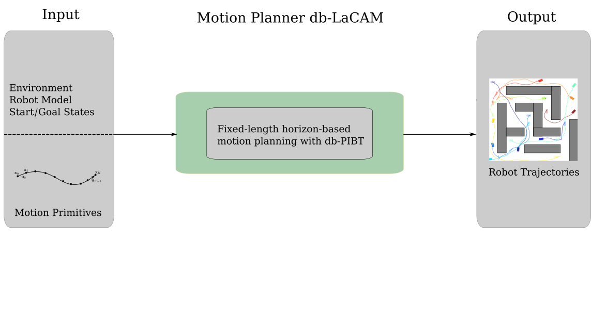
::::
:::{.element: class="fragment current-visible"}

::::
:::{.element: class="fragment current-visible"}

:::: 
:::{.element: class="fragment current-visible"}

::::
:::{.element: class="fragment current-visible"}
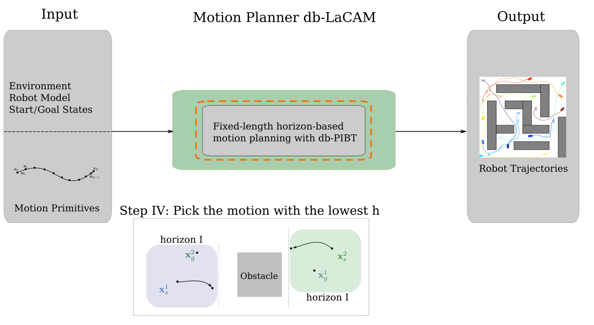
::::
:::{.element: class="fragment current-visible"}

::::
:::{.element: class="fragment"}

::::
:::


## db-Search: multi-robot motion planning

LaCAM + db-Search = db-LaCAM (<span style="font-size:0.6em; color:gray;">Okumura et al., 2023, Moldagalieva et al., 2026</span>)

```{=html}
<video data-autoplay loop muted playsinline src="media/video/icaps/icaps-gif.mp4" width="70%"></video>
```

## db-Search: Rollout

. . . 


3D environment + <span style="color: red">narrow pass</span>


## db-Search: Rollout


High-dimensional dynamics: <span style="color: red">Insufficient action resolution</span>

## db-Search: Rollout

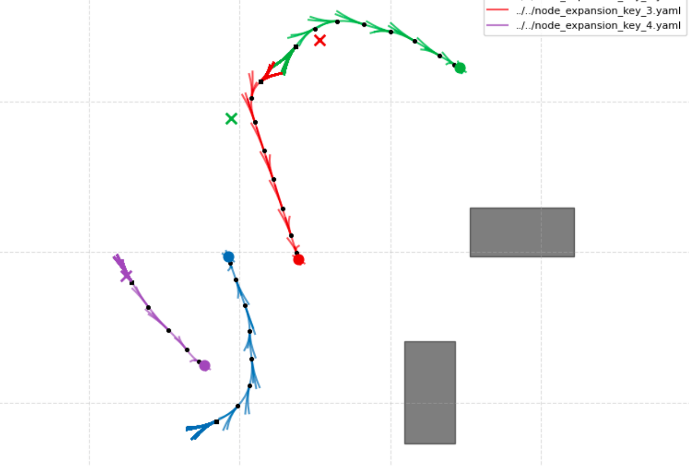

State history matters: robots may <span style="color: red">get stuck</span> due to velocity-dependent dynamics.


## Heuristic Estimation

. . . 

- Search efficiency

. . . 

- Euclidean distance might be not sufficient


## Heuristic Estimation - Hierarchical EST

Guided Expansive Spaces Trees: a search strategy for motion- and cost-constrained state spaces (EST) (<span style="font-size:0.6em; color:gray;">J. Phillips et al., 2004</span>)

::: {.r-stack}
:::{.element: class="fragment current-visible" data-fragment-index="1"}

::::
:::{.element: class="fragment current-visible" data-fragment-index="2"}
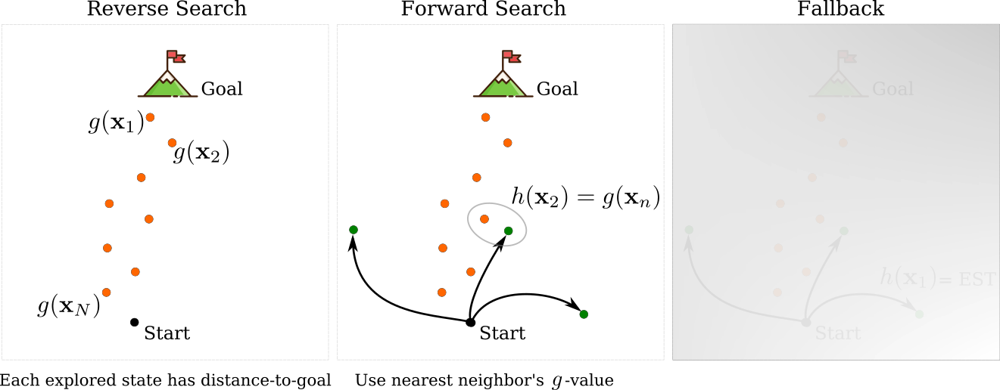
::::
:::{.element: class="fragment current-visible" data-fragment-index="3"}
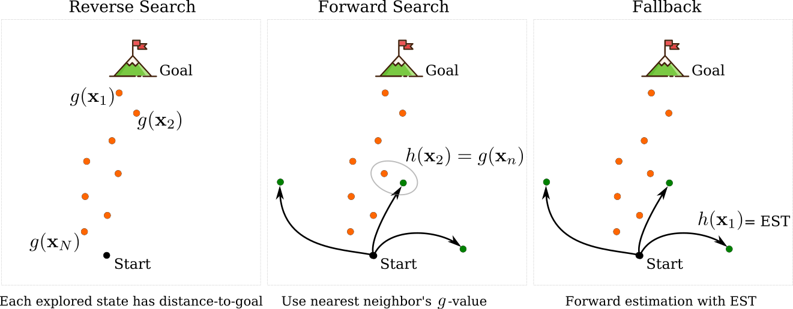
::::
:::{.element: class="fragment current-visible" data-fragment-index="4"}
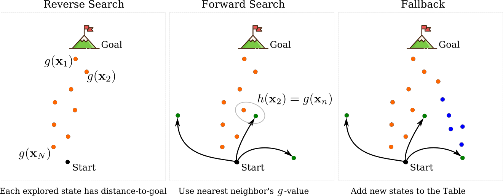
::::
:::

## Heuristic Estimation: Classic vs. Hierarchical EST


. . .

Still expensive for some dynamics, like car-with-trailer.


## Heuristic Estimation: Learning-based 

GAMBIT: Learning to Plan Continuous Multi-Robot Trajectories (<span style="font-size:0.6em; color:gray;">Jain et al., 2026</span>)

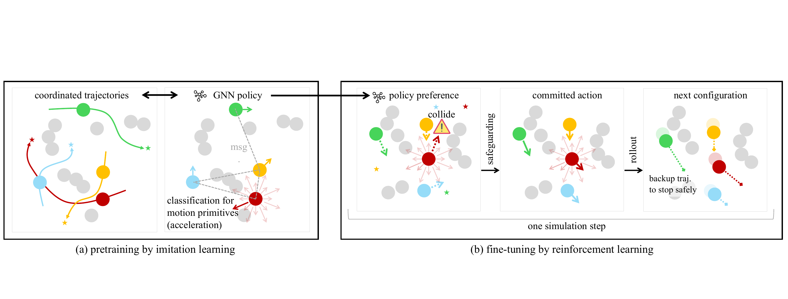

. . . 

Scalability up to $>1000$ double integrator dynamics


# Summary 


## Take Away

- Robot dynamics matter

. . . 

- Motion primitives-based search
  - stitch: expressive maneuvers, but computationally expensive
  - rollout: restricted maneuver discovery

. . . 

- Hybrid planners (classic + ML-based) is a promising direction.


## Thanks

<div style="text-align: left;">

Wolfgang Hönig (TU Berlin), Marc Toussaint (TU Berlin), Quim Ortiz-Haro (TU Berlin, IMPRS-IS), Keisuke Okumura (AIST, University of Cambridge), Amanda Prorok and Prorok Team (University of Cambridge).

. . . 

Thank you for your time!

<div>


## References I

<div style="text-align: left;">
Sharon, G., Stern, R., Felner, A., & Sturtevant, N. R. (2015). Conflict-based search for optimal multi-agent pathfinding. Artificial Intelligence (AIJ)<br>
Li, J., Chen, Z., Harabor, D., Stuckey, P. J., & Koenig, S. (2021). Anytime multi-agent path
finding via large neighborhood search. International Joint Conference on Artificial In-
telligence (IJCAI)<br>
Okumura, K. (2023). Lacam: Search-based algorithm for quick multi-agent pathfinding. Conference on Artificial Intelligence (AAAI)<br>
Hönig, W., Preiss, J. A., Kumar, T. K. S., Sukhatme, G. S., & Ayanian, N. (2018). Trajectory
planning for quadrotor swarms. IEEE Transactions on Robotics (T-RO)<br>
Luis, C. E., Vukosavljev, M., & Schoellig, A. P. (2020). Online trajectory generation with distributed model predictive control for multi-robot motion planning. IEEE Robotics and
Automation Letters (RA-L)<br>
Senbaslar, B., Hönig, W., & Ayanian, N. (2023). RLSS: real-time, decentralized, cooperative, net-
workless multi-robot trajectory planning using linear spatial separations. Autonomous
Robots<br> 
Yan, J., & Li, J. (2024). Multi-agent motion planning with bézier curve optimization under
kinodynamic constraints. IEEE Robotics and Automation Letters (RA-L)<br>
Hönig, W., Preiss, J. A., Kumar, T. K. S., Sukhatme, G. S., & Ayanian, N. (2018). Trajectory
planning for quadrotor swarms. IEEE Transactions on Robotics (T-RO)<br>
Jain, R., & Moldagalieva, A., Magnino, L., Amir, M., Okumura, K., Shankar, A., Hönig, W., Prorok, A. (2026). GAMBIT: Learning to Plan Continuous Multi-Robot Trajectories<br>
<div>


## References II

<div style="text-align: left;">
Moldagalieva, A., Ortiz-Haro, JQ., Toussaint, M., & Hönig, W. (2024). db-CBS: Discontinuity-Bounded Conflict-Based Search for Multi-Robot Kinodynamic Motion Planning. (ICRA)<br>
Moldagalieva, A., Ortiz-Haro, JQ., M., & Hönig, W. (2025). db-ECBS: db-ECBS: Interaction-Aware Multirobot Kinodynamic Motion Planning. (T-RO)<br>
Moldagalieva, A., Okumura, K., Prorok, A., M., & Hönig, W. (2026). db-lacam: Fast and scalable multi-robot kinodynamic motion planning with discontinuity-bounded search and lightweight mapf. (ICAPS)<br>
Phillips, J., Bedrossian, N., & Kavraki, L. (2004). Guided Expansive Spaces Trees: a search strategy for motion- and cost-constrained state spaces. (ICRA).<br>
Ortiz-Haro, JQ., Hönig, W., Toussaint, M. (2022). db-A$^\ast$: Discontinuity-bounded Search for Kinodynamic Mobile Robot Motion Planning. (ICRA)<br>
Ortiz-Haro, JQ., Hönig, W., Toussaint, M. (2024). iDb-A$^\ast$: Iterative search and optimization for optimal kinodynamic motion planning. (T-RO)<br>
<div>


