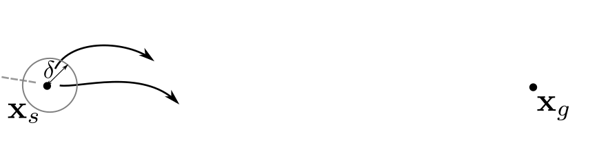
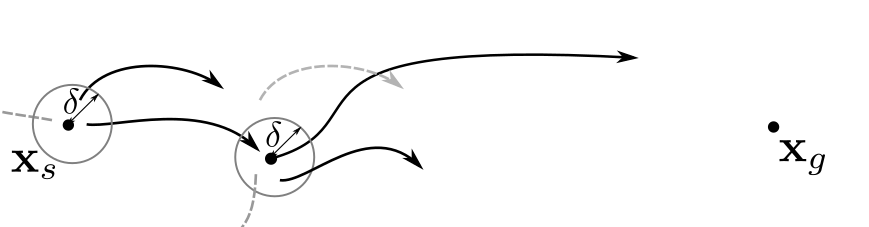

# Introduction 

## Background

The term *kinodynamic planing* was introduced to refer to motion planning problems for which velocity and acceleration bounds must be satisfied (<span style="font-size:0.6em; color:gray;">B. R. Donald, 1993</span>).

. . . 

Kinodynamic Motion Planning = Motion Planning $+$ Robot Dynamics


## Robot Dynamics


::: {.box-green}
:::: {.box-green-title}
Car-with-trailer Dynamics
::::
- States: $\mathbf{x} = (x, y, \theta_1, \theta_2)$
- Actions: $\mathbf{u} = (v, \phi)$
- Dynamics: $\mathbf{\dot{x} = \mathbf{f}(\mathbf{x}, \mathbf{u})}$, more precisely:

$\dot{x} = v \cos \theta_1, \quad \dot{y} = v \sin \theta_1, \quad \dot{\theta_1} = \frac{v}{L}\tan \phi$,  $\quad \dot{\theta_2} = \frac{v}{L_h} \sin (\theta_1 - \theta_2)$

:::

{width=400}

## Motion Planning with Robot Dynamics

{width=700}

. . .

Motion planning now considers *how* to move, not just where.


## Motion Planning with Robot Dynamics

<video 
  data-autoplay 
  src="media/video/icaps/mrmp-example.mp4"
  style="width: 70%; margin: 30px auto; display: block;">
</video>


# Kinodynamic Motion Planning Methods


## Kinodynamic Motion Plannin: MAPF + POST


{width=400}

<div style="font-size:0.6em; color:gray; margin-top:-1.1em;">
Hönig et al., 2018; Luis et al., 2020;
</div>

- Discrete motion planning
- Post-process with optimization
- <span style="color:red">Suboptimal trajectories</span>


## Kinodynamic Motion Planning: Bezier/Spline-based

{width=400}
<div style="font-size:0.6em; color:gray; margin-top:-1.1em;">
Senbaslar et al., 2023; Yan & Li, 2024;
</div>

- Discrete motion planning
- Post-process with optimization
- <span style="color:red">Limited dynamics</span>


## Kinodynamic Motion Planning: Motion Primitives

::: {.container}
:::: {.col .element: class="fragment" data-fragment-index="1"}
::: {.box-white}

<div style="font-size:0.6em; color:gray; margin-top:-1.1em;">
Shankar et al., 2025, Hou et al.,2025;
</div>
:::
- Discretized actions
- <span style="color:red">Expensive to hand craft</span>
::::

:::: {.col .element: class="fragment" data-fragment-index="2"}
::: {.box-white}

<div style="font-size:0.6em; color:gray; margin-top:-1.1em;">
Hönig et al., 2023; Moldagalieva et al., 2024, Moldagalieva et al., 2025;
</div>
:::
- Diverse maneuvers
- <span style="color:red">Stitching is non-trivial</span>
::::

:::


# discontinuity-bounded Search for Kinodynamic Motion Planning


## discontinuity-bounded Search

Allows for an user-defined discontinuity ($\delta$) between states (<span style="font-size:0.6em; color:gray;">Hönig et al., 2023 Ortiz-Haro et al., 2025</span>)

{width=600}


## discontinuity-bounded Search: Approach

::: {.r-stack}

:::{.element: class="fragment current-visible"}


::::
:::{.element: class="fragment current-visible"}


::::
:::{.element: class="fragment current-visible"}

::::

:::

Motion is applicable iff $d(\mathbf{x}_k, \mathbf{x}_m) \leq \delta$, 

$d : \mathcal{X} \times \mathcal{X} \rightarrow \mathbb{R}^{+}$ - function that measures the distance between two states

$\mathbf{x}_k$, $\mathbf{x}_m$ - robot state, motions first state.


## discontinuity-bounded Search: Raw Output


```{=html}
<video data-autoplay loop muted playsinline src="media/video/talks/jumpy-solution-dbcbs.mp4" width="50%"></video>
```

. . . 

Output is jumpy - infeasible for real robot platforms. How to Fix It?


## discontinuity-bounded Search: Fix discontinuous Jumps

With trajectory optimization 

```{=html}
<video data-autoplay loop muted playsinline src="media/video/talks/db-search.mp4" width="100%"></video>
```

## discontinuity-bounded Search: multi-robot planning

CBS/ECBS + db-Search (<span style="font-size:0.6em; color:gray;">Moldagalieva et al., 2024, 2025</span>)

```{=html}
<video data-autoplay loop muted playsinline src="media/video/talks/dbecbs-intro.mp4" width="100%"></video>
```


