## Overview

- Introduction

- Kinodynamic Motion Planning Methods

- db-Search for Single and Multi-Robot Kinodynamic Motion Planning

- Heuristic Estimation Methods

- Summary

# Introduction 

## Background

The term *kinodynamic planing* was introduced to refer to motion planning problems for which velocity and acceleration bounds must be satisfied (<span style="font-size:0.6em; color:gray;">B. R. Donald, 1993</span>).

. . . 

Kinodynamic Motion Planning = Motion Planning $+$ Robot Dynamics


## Robot Dynamics


::: {.box-green}
:::: {.box-green-title}
Car-with-trailer Dynamics
::::
- States: $\mathbf{x} = (x, y, \theta_1, \theta_2)$
- Actions: $\mathbf{u} = (v, \phi)$
- Dynamics: $\mathbf{\dot{x} = \mathbf{f}(\mathbf{x}, \mathbf{u})}$, more precisely:

$\dot{x} = v \cos \theta_1, \quad \dot{y} = v \sin \theta_1, \quad \dot{\theta_1} = \frac{v}{L}\tan \phi$,  $\quad \dot{\theta_2} = \frac{v}{L_h} \sin (\theta_1 - \theta_2)$

:::

{width=400}

## Motion Planning with Robot Dynamics

{width=700}

. . .

Motion planning now considers *how* to move, not just where.


## Motion Planning with Robot Dynamics

<video 
  data-autoplay 
  src="media/video/icaps/mrmp-example.mp4"
  style="width: 70%; margin: 30px auto; display: block;">
</video>


# Kinodynamic Motion Planning Methods


## Kinodynamic Motion Plannin: MAPF + POST


{width=400}

<div style="font-size:0.6em; color:gray; margin-top:-1.1em;">
Hönig et al., 2018; Luis et al., 2020;
</div>

- Discrete motion planning
- Post-process with optimization
- <span style="color:red">Suboptimal trajectories</span>


## Kinodynamic Motion Planning: Bezier/Spline-based

{width=400}
<div style="font-size:0.6em; color:gray; margin-top:-1.1em;">
Senbaslar et al., 2023; Yan & Li, 2024;
</div>

- Discrete motion planning
- Post-process with optimization
- <span style="color:red">Limited dynamics</span>


## Kinodynamic Motion Planning: Motion Primitives

::: {.container}
:::: {.col .element: class="fragment" data-fragment-index="1"}
::: {.box-white}

<div style="font-size:0.6em; color:gray; margin-top:-1.1em;">
Shankar et al., 2025, Hou et al.,2025;
</div>
:::
- Discretized actions
- <span style="color:red">Expensive to hand craft</span>
::::

:::: {.col .element: class="fragment" data-fragment-index="2"}
::: {.box-white}

<div style="font-size:0.6em; color:gray; margin-top:-1.1em;">
Hönig et al., 2023; Moldagalieva et al., 2024, Moldagalieva et al., 2025;
</div>
:::
- Diverse maneuvers
- <span style="color:red">Stitching is non-trivial</span>
::::

:::


# discontinuity-bounded Search for Kinodynamic Motion Planning


## discontinuity-bounded/db-Search

Allows for an user-defined discontinuity ($\delta$) between states (<span style="font-size:0.6em; color:gray;">Hönig et al., 2023 Ortiz-Haro et al., 2025</span>)

{width=600}


## db-Search: Discrete Search

::: {.r-stack}

:::{.element: class="fragment current-visible"}


::::
:::{.element: class="fragment current-visible"}


::::
:::{.element: class="fragment current-visible"}

::::

:::

Motion is applicable iff $d(\mathbf{x}_k, \mathbf{x}_m) \leq \delta$, 

$d : \mathcal{X} \times \mathcal{X} \rightarrow \mathbb{R}^{+}$ - function that measures the distance between two states

$\mathbf{x}_k$, $\mathbf{x}_m$ - robot state, motions first state.


## db-Search: Discrete Search Output 


## db-Search: Discrete Search Output


```{=html}
<video data-autoplay loop muted playsinline src="media/video/talks/jumpy-solution-dbcbs.mp4" width="60%"></video>
```

. . . 

Output is jumpy - infeasible for real robot platforms. How to Fix It?


## db-Search: Fix discontinuous Jumps

With trajectory optimization (<span style="font-size:0.6em; color:gray;">Hönig et al., 2023 Ortiz-Haro et al., 2025</span>)

```{=html}
<video data-autoplay loop muted playsinline src="media/video/talks/db-search.mp4" width="100%"></video>
```

## db-Search: multi-robot motion planning

CBS/ECBS + db-Search = db-CBS (<span style="font-size:0.6em; color:gray;">Sharon et al., 2015, Moldagalieva et al., 2024, Moldagalieva et al., 2025</span>)

::: {.r-stack}

:::{.element: class="fragment current-visible"}
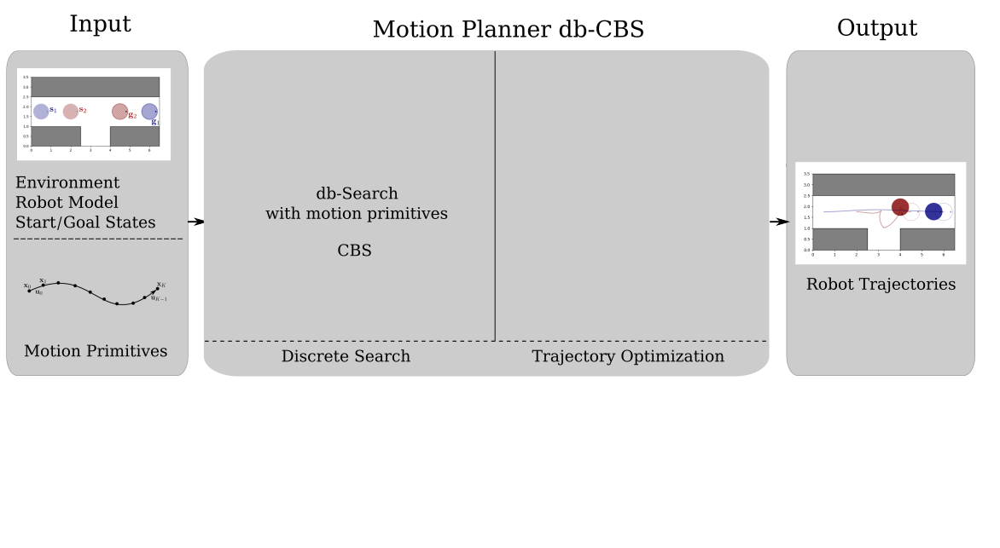

::::
:::{.element: class="fragment current-visible"}
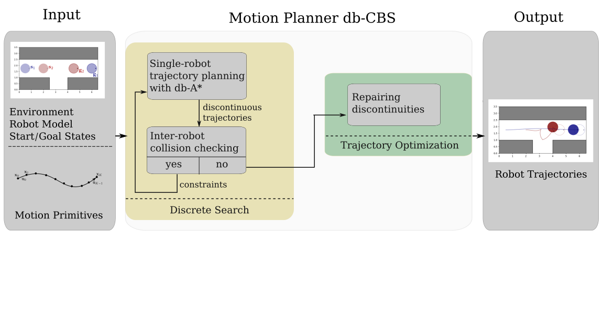

::::
:::{.element: class="fragment current-visible"}

::::
:::{.element: class="fragment current-visible"}

:::: 
:::{.element: class="fragment"}

::::
:::


## db-Search: multi-robot motion planning

CBS/ECBS + db-Search (<span style="font-size:0.6em; color:gray;">Moldagalieva et al., 2024, Moldagalieva et al., 2025</span>)

```{=html}
<video data-autoplay loop muted playsinline src="media/video/talks/dbecbs-intro.mp4" width="100%"></video>
```


## db-Search with Optimization


\begin{equation}
  \mathcal{O}\left(K\left(\sum_{i=1}^{N} \max\left(d_x^{(i)},d_u^{(i)}\right)\right)^3\right)
\end{equation}

$d^{(i)}_x, d^{(i)}_u$ - state and action dimensions of robot $i$, 
$N$ - number of robots, 
$K = \max_{i \in N} K^{(i)}$, $K^{(i)}$ - number of time steps in the discrete search solution of the $i^{\text{th}}$ robot.

## Kinodynamic Motion Planning: Motion Primitives 


. . . 

No discontinuity *$\rightarrow$* No optimization


## db-Search with Rollout

::: {.r-stack}

:::{.element: class="fragment current-visible"}


::::
:::{.element: class="fragment current-visible"}


::::
:::{.element: class="fragment current-visible"}
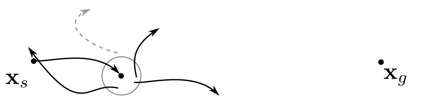


::::
:::{.element: class="fragment current-visible"}


::::
:::{.element: class="fragment current-visible"}


::::
:::{.element: class="fragment current-visible"}


::::
:::{.element: class="fragment current-visible"}


::::

:::


## db-Search: multi-robot motion planning

LaCAM + db-Search = db-LaCAM (<span style="font-size:0.6em; color:gray;">Okumura et al., 2023, Moldagalieva et al., 2026</span>)

::: {.r-stack}

:::{.element: class="fragment current-visible"}

::::
:::{.element: class="fragment current-visible"}

::::
:::{.element: class="fragment current-visible"}
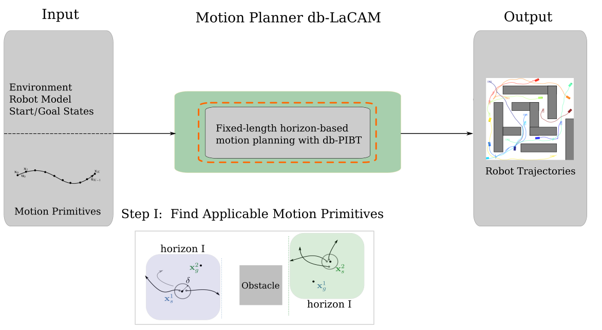
::::
:::{.element: class="fragment current-visible"}
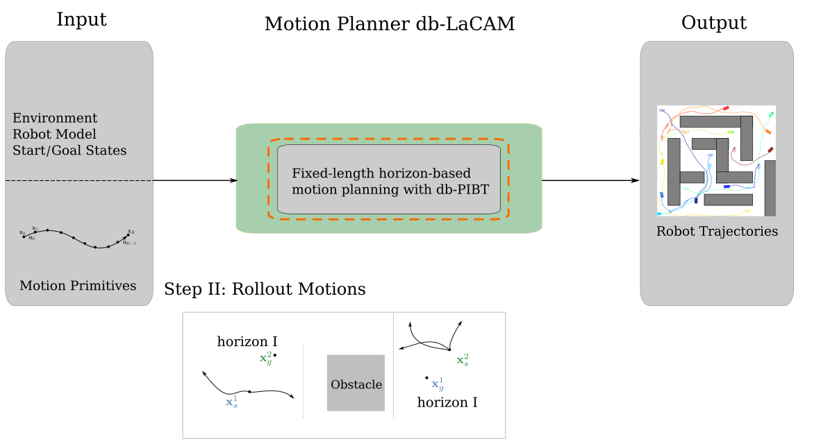
:::: 
:::{.element: class="fragment current-visible"}

::::
:::{.element: class="fragment current-visible"}

::::
:::{.element: class="fragment current-visible"}
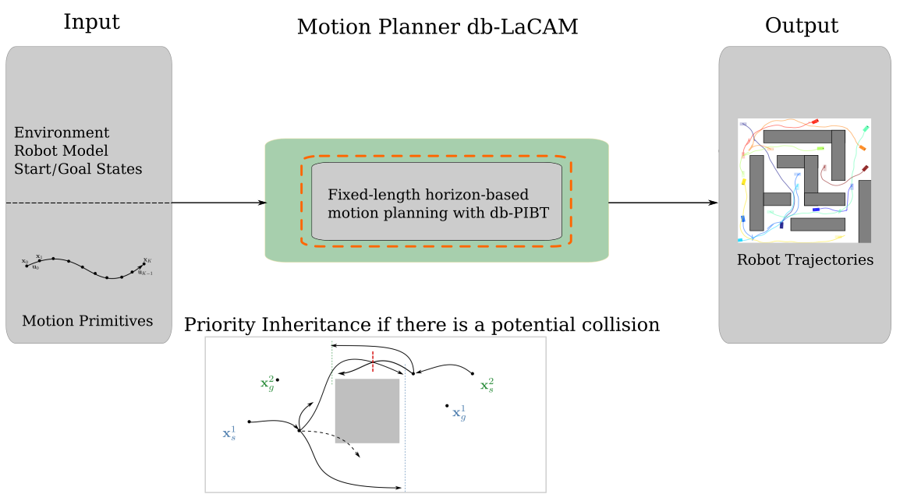
::::
:::{.element: class="fragment"}
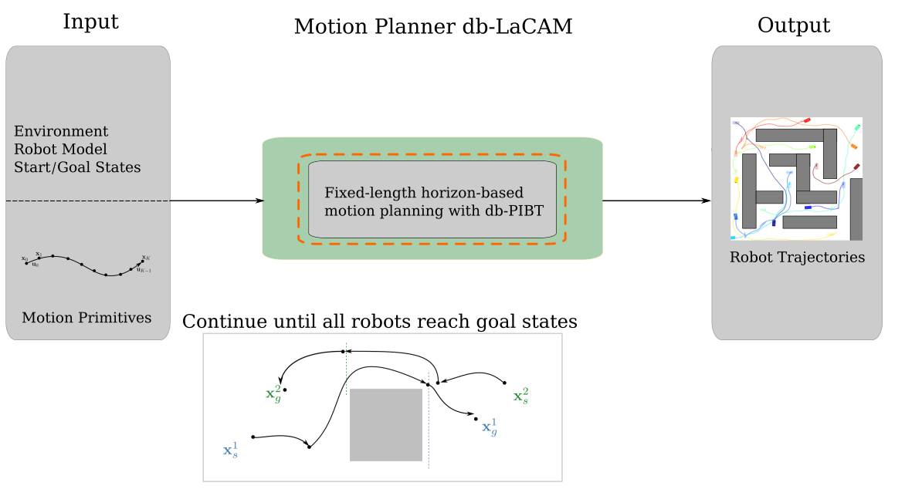
::::
:::


## db-Search: multi-robot motion planning

LaCAM + db-Search = db-LaCAM (<span style="font-size:0.6em; color:gray;">Okumura et al., 2023, Moldagalieva et al., 2026</span>)

```{=html}
<video data-autoplay loop muted playsinline src="media/video/icaps/icaps-gif.mp4" width="70%"></video>
```

## db-Search: Rollout

. . . 

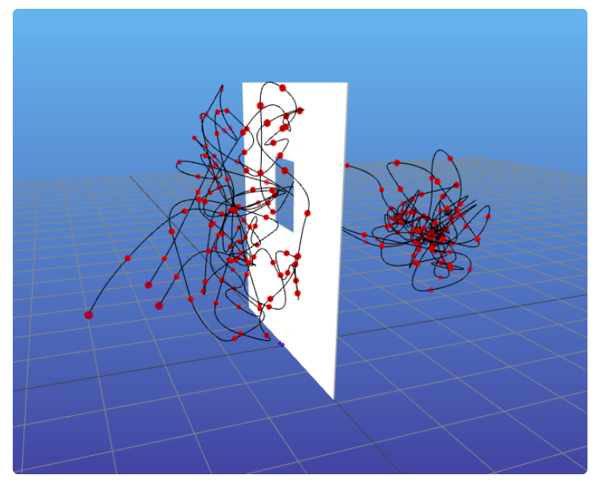

3D environment + <span style="color: red">narrow pass</span>


## db-Search: Rollout

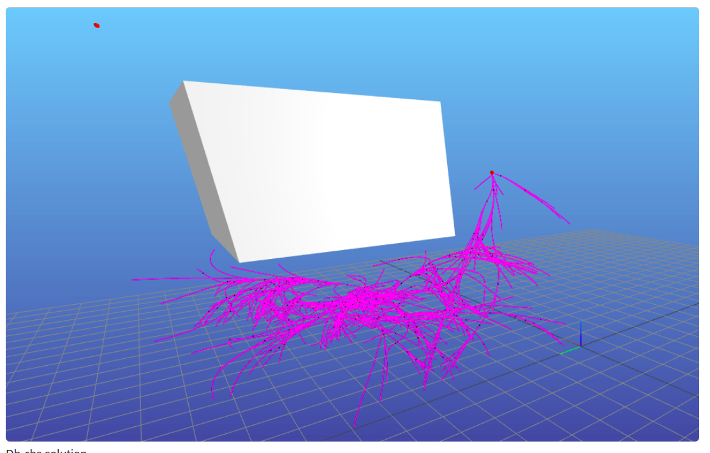

High-dimensional dynamics - <span style="color: red">Lipschitz continuity</span> breaks


## db-Search: Heuristic Estimation

. . . 

- Search efficiency

. . . 

- Euclidean distance might be not sufficient


## db-Search: Heuristic Estimation - Classic

::: {.r-stack}
:::{.element: class="fragment current-visible" data-fragment-index="1"}
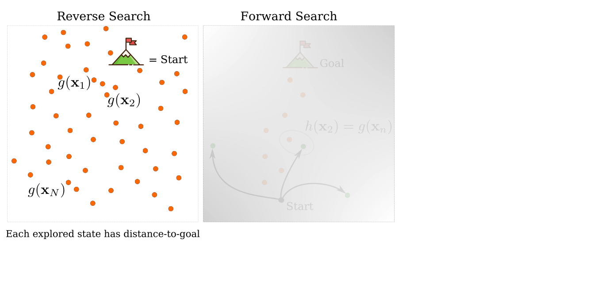
::::
:::{.element: class="fragment current-visible" data-fragment-index="2"}
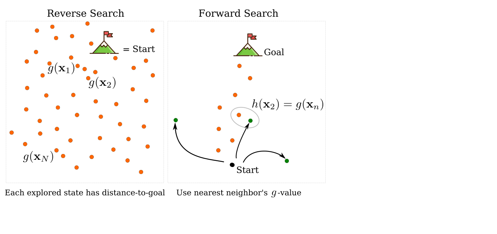
::::

:::

## db-Search: Heuristic Estimation - Hierarchical EST

Guided Expansive Spaces Trees: a search strategy for motion- and cost-constrained state spaces (EST) (<span style="font-size:0.6em; color:gray;">J. Phillips et al., 2004</span>)

::: {.r-stack}
:::{.element: class="fragment current-visible" data-fragment-index="1"}
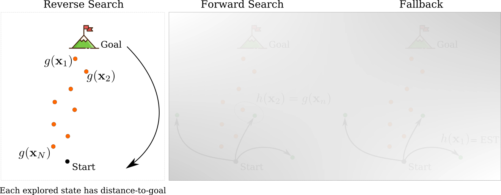
::::
:::{.element: class="fragment current-visible" data-fragment-index="2"}

::::
:::{.element: class="fragment current-visible" data-fragment-index="3"}

::::
:::{.element: class="fragment current-visible" data-fragment-index="4"}

::::
:::

## db-Search: Classic vs. Hierarchical EST heuristic estimation

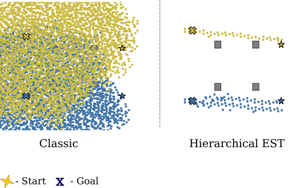


# Summary 


